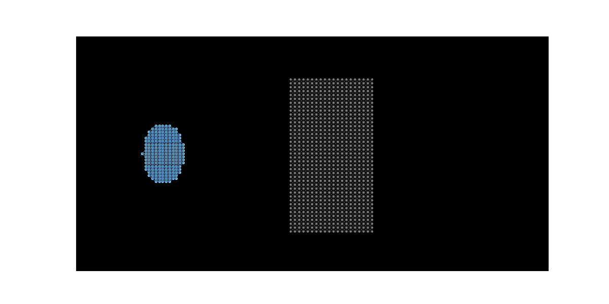
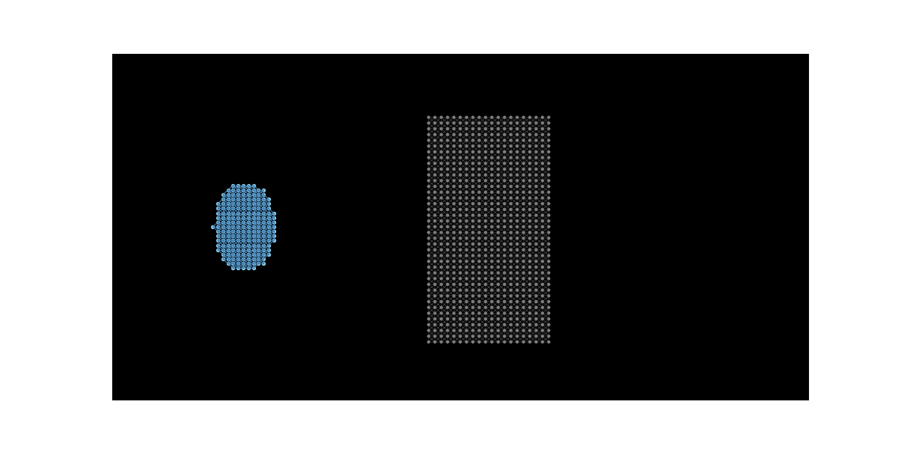
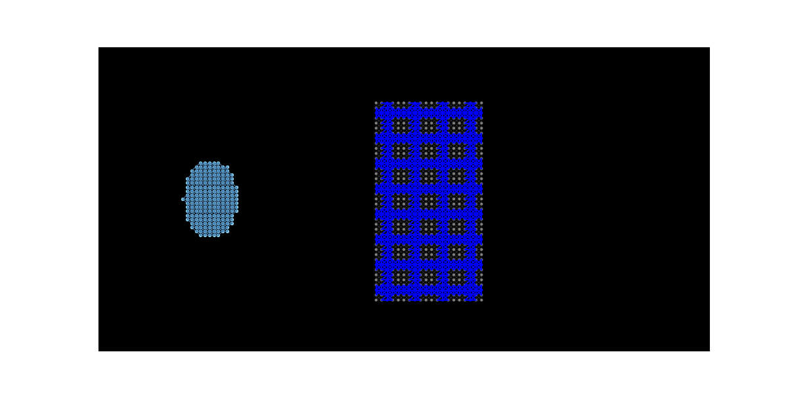

Проект динамики разрушения
## Теоретическая часть

### Описание задачи

В основе разработанной модели лежит представление о том, что сплошная среда (бетонная плита, стальная арматура и чугунный ударник) может быть аппроксимирована совокупностью большого числа взаимодействующих материальных точек (частиц). Каждая *i*-я частица имеет массу *mi*, текущее положение *ri* и скорость *vi*.

Такой подход (близкий к методу дискретных элементов, DEM) позволяет естественным образом моделировать разрушение как процесс разрыва связей между отдельными частицами, что вычислительно проще, чем перестройка сетки в методе конечных элементов (FEM).

### Уравнение движения и численное интегрирование (метод Верле)

Движение каждой частицы описывается вторым законом Ньютона:

$$
m_i a_i = F_i,
$$

где *ai* — ускорение, а *Fi* — суммарная сила, действующая на частицу.

Для решения этого уравнения в коде используется метод интегрирования Верле, который обеспечивает хорошую сохранность энергии системы и устойчивость при больших шагах по времени. Координаты частицы на следующем шаге *t + Δt* вычисляются по формуле:

$$
r_i(t + \Delta t) = 2r_i(t) - r_i(t - \Delta t) + a_i(t)\Delta t^2.
$$

Скорость частицы (используемая для кинетической энергии и визуализации) вычисляется через центральную разность:

$$
v_i(t) = \frac{r_i(t + \Delta t) - r_i(t - \Delta t)}{2\Delta t}.
$$

### Моделирование внутренних сил (упругие связи)

Внутри каждого тела частицы соединены виртуальными связями. Сила упругого взаимодействия между частицами *i* и *j* описывается законом Гука:

$$
F_{ij} = k_{ij}\left(|r_j - r_i| - L_{ij}\right)\frac{r_j - r_i}{|r_j - r_i|},
$$

где *kij* — жёсткость связи, *Lij* — начальная длина связи. Эта сила стремится вернуть частицы в исходное положение.

### Модели разрушения материалов (критерии разрыва связей)

В коде реализованы три разных подхода к разрушению, отражающих физическую природу материалов. Относительная деформация связи вычисляется как:

$$
\varepsilon = \frac{|r_j - r_i| - L_{ij}}{L_{ij}}.
$$

#### Бетон (накопление повреждений)

Бетон — хрупкий материал. В коде реализована упрощённая модель накопления повреждений (по мотивам модели RHT). Каждая частица имеет параметр повреждённости *D ∈ [0, 1]*. Если деформация связи превышает предел прочности бетона *εc*, происходит приращение повреждённости:

$$
\Delta D = C \cdot (|\varepsilon| - \varepsilon_c),
$$

где *C* — коэффициент скорости накопления (в коде *C = 25.0*). Повреждённость накапливается на обеих частицах связи. Жёсткость связи падает с ростом повреждённости (деградация материала):

$$
k_{\text{eff}} = k_0\left(1 - 0.9 \cdot \max(D_1, D_2)\right).
$$

Связь разрывается, когда повреждённость хотя бы одной из частиц достигает *D = 1.0*.

#### Чугун (хрупкий разрыв при растяжении)

Чугун — хрупкий материал, плохо работающий на растяжение. В коде для связей `iron_link` реализовано условие:

$$
\varepsilon > \varepsilon_{\text{iron}} \implies \text{связь мгновенно рвётся}.
$$

При сжатии (*ε < 0*) чугун работает стабильно без разрушения. Это имитирует образование трещин отрыва при ударе.

#### Арматура (сталь Ст3, пластичное разрушение)

Сталь Ст3 — пластичный материал. В коде для связей `rebar_link` реализовано условие:

$$
|\varepsilon| > \varepsilon_{\text{steel}} \implies \text{связь мгновенно рвётся},
$$

где *εsteel* (в коде `rebar_max_strain = 0.12`) значительно превышает пределы для бетона и чугуна, что отражает высокую пластичность стали Ст3.

### Модель контактного взаимодействия

Контакт между ударником и преградой моделируется через силы отталкивания на основе перекрытия. Если расстояние между частицей преграды *w* и частицей ударника *p* меньше радиуса контакта *Rc* (в коде *Rc = 6.0*), возникает сила:

$$
F_{\text{contact}} = K_c \cdot (1 - 0.8 \cdot D_w) \cdot (R_c - |r_w - r_p|) \cdot \frac{r_w - r_p}{|r_w - r_p|},
$$

где *Kc* — жёсткость контакта (в коде *50000.0*), *Dw* — повреждённость частицы бетона (разрушенный бетон хуже сопротивляется). Контакт также наносит дополнительные повреждения бетону:

$$
\text{если } |F_{\text{contact}}| > 5000, \text{ то } D_w = 0.05.
$$

### Геометрия овального ударника

Ударник задаётся как эллипс. Частицы генерируются только внутри области, удовлетворяющей уравнению:

$$
\frac{(x - x_0)^2}{a^2} + \frac{(y - y_0)^2}{b^2} \le 1,
$$

где *(x₀, y₀)* — координаты центра, *a* и *b* — полуоси. Связи между частицами ударника создаются, если расстояние между ними не превышает *1.5*.

Интерфейс: 
python bet.py --speed скорость проникателя --strength Умножает предел прочности бетона на растяжение/сжатие  --stiffness Умножает жесткость связей внутри бетона --frames число кадров --output название файла.gif

Пробитие бетонного блока чугунным предметом
Варьируется прочность бетона
Пробитие бетона малой прочности

Пробитие бетона средней прочности

Пробитие бетона высокой прочности

Варьируется скорость проникателя при фиксированной высокой прочности бетона
Пробитие бетона на низкой скорости

Пробитие бетона на средней скорости

Пробитие бетона на высокой скорости

Пробитие железобетонного блока чугунным предметом
Варьируется прочность железобетона
Пробитие железобетона малой прочности

Пробитие железобетона средней прочности

Пробитие железобетона высокой прочности

Варьируется скорость проникателя при фиксированной высокой прочности железобетона
Пробитие железобетона на малой скорости проникателя

Пробитие железобетона на средней скорости проникателя

Пробитие железобетона на высокой скорости проникателя

